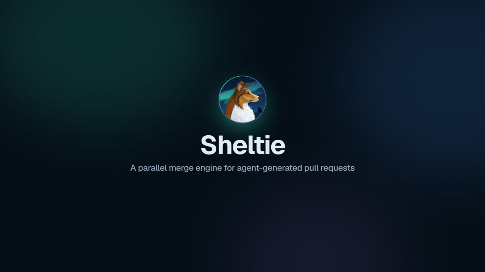

<p align="center">
  
</p>

<h1 align="center">Sheltie</h1>

<p align="center"><b>A parallel merge engine for agent-generated pull requests.</b><br>
<a href="https://sheltie.dev">sheltie.dev</a> · <a href="https://sheltie.dev/#video">Video</a> · <a href="https://sheltie.dev/docs/">Docs</a> · <a href="https://sheltie.dev/docs/self-hosting.html">Self-hosting</a></p>

<p align="center"><a href="https://sheltie.dev/#video"></a><br>
<a href="https://sheltie.dev/#video">▶ Watch the explainer (3:29)</a>: footprints, parallel landing, conflict tiers, a real conflict re-derived from its intent, the dashboard and the ROI report.</p>

Coding agents open more pull requests than a one-at-a-time merge queue can land. Sheltie runs as
a GitHub App next to your existing CI. It computes a *footprint* for every pull request (which
build targets it writes and which it affects), lands independent pull requests in parallel, and
resolves conflicts in escalating tiers:
1. structural merge;
2. regenerating derived files;
3. declared merge rules;
4. re-deriving the change from the agent's recorded intent.

Before work starts, it also keeps agents off overlapping issues.

> **Status: early (0.x).** Cargo is the supported build tool. Start in shadow mode, where Sheltie
> only reports what it would do, before letting it merge.

## How it works

1. An agent opens a pull request; GitHub notifies Sheltie.
2. An adapter (`sheltie-cargo`) runs on your CI runner and uploads the footprint.
3. The scheduler lands independent pull requests in parallel. Conflicting ones are built
   speculatively together or sent to the merge engine.
4. The committer checks that nothing that landed meanwhile touches the change, then
   fast-forwards the default branch. It never force-pushes.
5. Sweeps watch the default branch; a red commit is bisected and reverted automatically.

Builds, tests and agent jobs run on **your** runners with **your** API keys. The control plane
only does set arithmetic and talks to GitHub.

## Self-host in about 30 minutes

You need a host with Docker and a public HTTPS name, and a browser to register the GitHub App.

```sh
git clone https://github.com/softberries/sheltie && cd sheltie
scripts/register-github-app.py --url https://sheltie.example.com   # writes .env and the App key
docker compose up -d --build
curl -s localhost:8080/healthz                                       # {"status":"ok"}
```

Then put a TLS reverse proxy in front of port 8080, install the App on your repositories, and
add the footprint workflow. The full guide, including Kubernetes (Helm), is
[Self-hosting](https://sheltie.dev/docs/self-hosting.html).

## Documentation

The documentation is at [sheltie.dev/docs](https://sheltie.dev/docs/):

- [Self-hosting](https://sheltie.dev/docs/self-hosting.html) and [configuration](https://sheltie.dev/docs/configuration.html)
- [Workflows](https://sheltie.dev/docs/workflows.html) to add to your repositories
- [Merge rules](https://sheltie.dev/docs/merge-rules.html) and [intent replay](https://sheltie.dev/docs/intent-replay.html)
- [Coordinating agents](https://sheltie.dev/docs/agents.html) (MCP server, issue leases)
- [Dashboard](https://sheltie.dev/docs/dashboard.html), including the time-saved estimate
- [Changelog](CHANGELOG.md)

Its source is in [`docs/`](docs/); build it locally with `mdbook build docs` (output in `target/book`).

## Supported build tools

| Build tool | Status |
| --- | --- |
| Cargo | Supported |
| sbt, Mill, Gradle, Bazel (via BSP) | Planned |
| Maven | Planned |

## Development

Requirements: Rust (via rustup; the toolchain is pinned in `rust-toolchain.toml`) and Docker.

```sh
cp .env.example .env
docker compose -f deploy/docker-compose.yml up -d   # Postgres for development
cargo build --workspace
cargo nextest run --workspace                       # DB tests read DATABASE_URL from .env
cargo run -p sheltie-server                         # then: curl localhost:8080/healthz
```

To develop against a real GitHub App, follow "Running the GitHub App locally" in
[CONTRIBUTING.md](CONTRIBUTING.md), which also describes the workflow and conventions.

## License

Licensed under the [Apache License, Version 2.0](LICENSE).

---

Built by [Softberries](https://softberries.dev).
