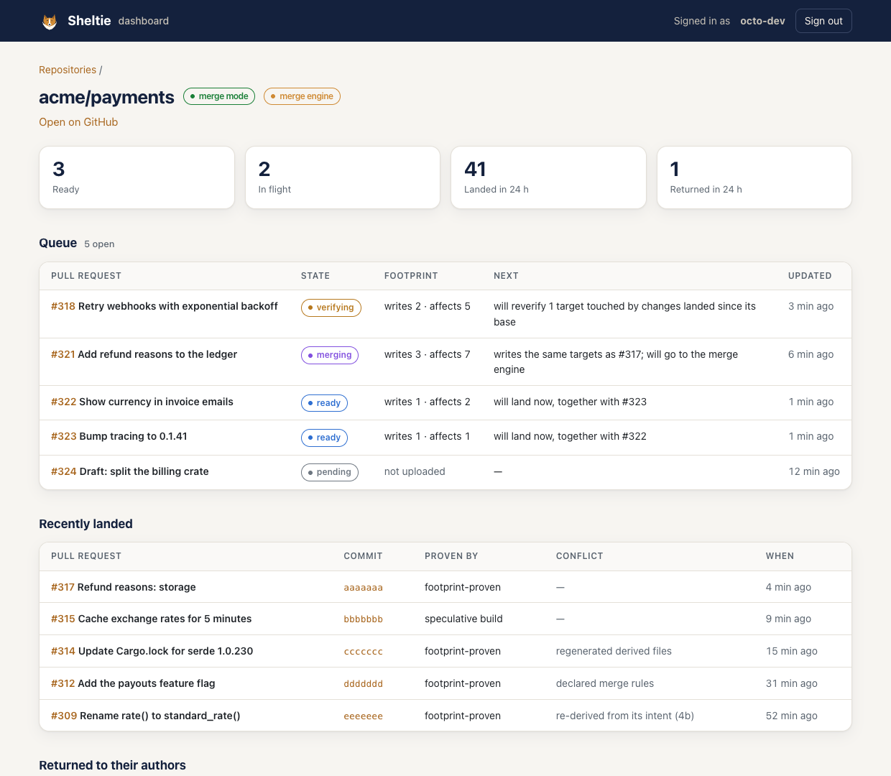

# Self-hosting

You run the control plane (one small container and Postgres) and register your own GitHub App.
Plan for about 30 minutes.

## What you need

- A Linux host with Docker (Compose v2), reachable from the internet over HTTPS at a host name
  of yours, for example `sheltie.example.com`. GitHub sends webhooks there and your CI uploads
  footprints there.
- A machine with a browser, Python 3 and a clone of this repository, to register the App.
- Owner or admin rights on the GitHub account or organization whose repositories Sheltie will
  manage.

## 1. Register the GitHub App

On the machine with the browser, in a clone of the repository:

```sh
scripts/register-github-app.py --url https://sheltie.example.com
# add --org your-org to register it under an organization
```

Confirm the App on GitHub when the browser opens. The script writes:

- `sheltie-github-app.pem`: the App's private key (mode 600, git-ignored);
- `.env`: the App id and webhook secret, a random Postgres password, `SHELTIE_PUBLIC_HOSTS`
  and `SHELTIE_UID`.

No secret is printed.

## 2. Start Sheltie

On the host, in a clone of the repository, put the two files from step 1 in the repository
root. If you registered the App on another machine, set `SHELTIE_UID` in `.env` to the
output of `id -u` on the host: the server runs as that user so it can read the mode-600 key.

```sh
docker compose up -d --build
curl -s localhost:8080/healthz      # {"status":"ok"}
```

`--build` builds the image from source (a few minutes). Once releases are published you can
use `ghcr.io/softberries/sheltie` instead: set `SHELTIE_IMAGE` in `.env` and drop `--build`.

The server listens on `127.0.0.1:8080`. Put a TLS-terminating reverse proxy in front of it.
With [Caddy](https://caddyserver.com/), which gets certificates automatically:

```text
sheltie.example.com {
    reverse_proxy 127.0.0.1:8080
}
```

Check from outside: `curl https://sheltie.example.com/healthz`.

## 3. Install the App

Open the App's page (the script printed its URL), choose **Install**, and select the
repositories Sheltie should manage. Each repository starts in **shadow mode**: Sheltie posts
a **Sheltie** check on every pull request with what it would do, but merges nothing.

## 4. Add the workflows

In each repository, add the footprint workflow so Sheltie learns what every pull request
touches. See [Workflows](workflows.md) for the file to add, and for the optional merge-engine
and replay workflows.

Open a pull request: the **Sheltie** check appears within seconds, and shows the footprint
once the workflow has run.

## 5. Let Sheltie merge

After a few days in shadow mode, look at how often Sheltie's predictions would have been
wrong:

```sh
docker compose exec sheltie sheltie-server shadow-report --repo your-org/your-repo
```

Before switching a repository to merge mode:

- CI must run on pushes to branches under `sheltie/` (Sheltie verifies changes on
  `sheltie/verify/*`, `sheltie/spec/*` and `sheltie/bisect/*`). Most workflows that run
  `on: push` already do.
- If the default branch is protected, add the App to the ruleset's bypass list: Sheltie lands
  changes by fast-forwarding the branch. It never force-pushes.

Then:

```sh
docker compose exec sheltie sheltie-server repo set-mode --repo your-org/your-repo --mode merge
```

Switch back at any time with `--mode shadow`. To turn on the merge engine for a repository
that has the merge workflow: `sheltie-server repo set-merge-engine --repo your-org/your-repo --state on`.

## Dashboard

Open `https://sheltie.example.com/dashboard` and sign in with GitHub. You see the
repositories where the App is installed and you have access: the queue, what landed and how
it was proven, pull requests returned to their authors, and agents' claimed issues.



The registration script sets it up (`SHELTIE_PUBLIC_URL` and the App's OAuth client id and
secret). For an App registered before, add `https://sheltie.example.com/auth/callback` as a
callback URL in the App's settings, generate a client secret there, and set the three
variables (see [Configuration](configuration.md)).

## Kubernetes

A Helm chart is in `deploy/helm/sheltie`. Postgres is not included: use a managed database or
an operator such as CloudNativePG, and put the connection URL in a Secret.

```sh
kubectl create secret generic sheltie-database --from-literal=url='postgres://…'
kubectl create secret generic sheltie-github \
  --from-literal=app-id=123456 --from-literal=webhook-secret='…' \
  --from-file=private-key.pem=sheltie-github-app.pem
helm install sheltie deploy/helm/sheltie \
  --set ingress.enabled=true --set ingress.hosts[0].host=sheltie.example.com
```

Take the App id and webhook secret from the `.env` the registration script wrote. See
`deploy/helm/sheltie/values.yaml` for all settings.

## Operating

- Upgrades: pull or build the new image and restart; migrations run on startup.
- Logs go to stderr; set `RUST_LOG` (for example `info,sheltie_server=debug`) for more.
- Backups: back up Postgres. Everything else can be rebuilt from GitHub.
- `sheltie-server stats` prints anonymous counts (no names) if you want to share how you use
  Sheltie. Sheltie sends no telemetry.
